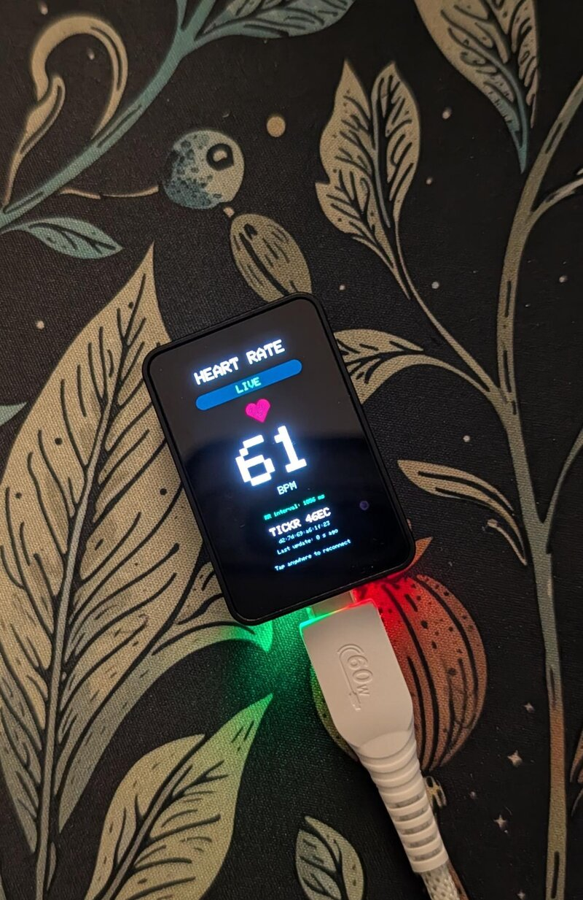

# Heart Rate

Live Wahoo heart rate on the **Waveshare ESP32-S3-Touch-AMOLED-1.64**.

<p align="center">
  <a href="tickr.jpg"></a>
</p>

<p align="center"><em>Live reading from a Wahoo TICKR on the onboard AMOLED.</em></p>

- Automatically scans for Wahoo / TICKR / TRACKR devices advertising the standard
  Bluetooth LE Heart Rate service (`0x180D`), then subscribes to measurements
  (`0x2A37`). No phone, Wi-Fi, PIN, or Bluetooth bonding is required.
- Large BPM readout, connection status, strap name/address, and time since the
  last measurement. Shows the latest RR interval when the strap supplies it.
- Blanks BPM after 5 seconds without data, on lost skin contact (when reported),
  or when disconnected. Reconnects after disconnection or 20 seconds without data.
- Tap anywhere to reconnect. Scanning/connecting runs in a separate task so the
  display and touch remain responsive. A tap during a scan/connection may take
  until that operation finishes to take effect.
- The heart icon flashes on incoming measurements; it is not an ECG or a
  precisely timed heartbeat indicator. This is not a medical device.

## Build and upload

Uses ESP32 core **3.3.12** and **GFX Library for Arduino 1.6.9**. Bluetooth comes
with the ESP32 core; no additional BLE library is needed. The profile enables
USB serial, PSRAM for the framebuffer, and a 3 MB application partition.

From this directory:

```bash
arduino-cli compile --profile esp32 .
arduino-cli upload --profile esp32 --port /dev/esp32 .
```

Change the port if needed. Uploading replaces the sketch currently on the board.

## Connect your strap

1. Put the strap on and wet the chest electrodes to wake it (or turn on your
   optical strap). Keep it near the board.
2. Boot the board; it will find and connect to the first matching advertisement.
3. Wait for **LIVE** and the BPM reading. If it shows **CHECK STRAP**, adjust skin
   contact. If it cannot connect, disconnect the strap from phone/watch apps
   that may be using its available BLE connections.

This requires a **Bluetooth LE capable** strap; ANT+-only straps cannot connect.
The strap must advertise its name and Heart Rate service for automatic discovery.
If yours uses a different name, or several straps are nearby, set `TARGET_ADDRESS`
at the top of `HeartRate.ino` to its BLE address (for example `aa:bb:cc:dd:ee:ff`).
This bypasses the name/service advertisement filter; the connected device must
still expose the standard Heart Rate service. BLE addresses can change on
devices using address privacy. The target is compiled in, not saved by tapping.

Serial diagnostics at 115200 baud list discovered HR/Wahoo candidates and
connection progress. No persistent pairing/bond is created.

## Hardware

Same display/touch wiring as the other sketches: CO5300 QSPI on CS 46, SCK 10,
D0–D3 11–14, RST 21, with a 20-column display offset. FT3168 touch uses I²C
SDA 47 / SCL 48, address `0x38`.

## Host tests

From this directory, test packet decoding, optional RR/energy fields, contact
flags, malformed packets, Wahoo name matching, and timer wraparound:

```bash
g++ -std=c++11 -Wall -Wextra -Werror -fsanitize=address,undefined \
  tests/heart_rate_test.cpp -o /tmp/opencode/heart_rate_test
/tmp/opencode/heart_rate_test
```
